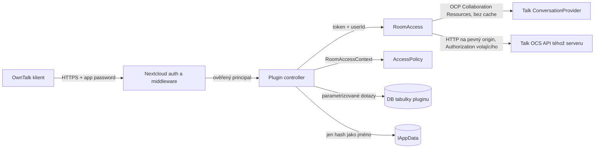

# OwnTalk Extensions: sdílená nastavení konverzací

Implementační plán volitelné Nextcloud aplikace (server pluginu) pro OwnTalk.
Plugin ukládá a distribuuje nastavení Talk konverzace, která standardní Talk
API neumí: sdílený vzhled (barvy, tapeta), rychlou emoji v composeru
a přezdívky účastníků. Platí pro 1:1 i skupinové konverzace. Sdílené hodnoty
vidí všichni účastníci na všech zařízeních s OwnTalkem, osobní hodnoty jen
jejich autor na svých zařízeních.

Stav k 12. 11. 2026: první řez je implementovaný v
[nks-hub/owntalk-extensions](https://github.com/nks-hub/owntalk-extensions)
0.1.0: členství (kap. 9.1), role přes Talk OCS (kap. 9.2), sdílená nastavení
barev a rychlé emoji (`GET`/`PATCH`), capability. Brány S0 a S0b prošly
integrační sadou `tests/integration/acl_test.py` na NC 34.0.5 + Talk 24.0.7
i NC 35.0.2 + Talk 25.0.7 (40/40, v režimu bez rolí 37/37). Přezdívky, osobní
preference, obrázky, `/revisions` a úklidový job zatím chybí. Zjištění z běhu:
Talk přidá pozvaného účastníka 1:1 až první zprávou, do té doby vrací 404
i Talk sám. Tvrzení o Nextcloudu
a Talku jsou vázaná na SHA nebo dokumentaci uvedenou v textu. Co nebylo
ověřeno, je označeno **k ověření**. Bezpečnostní tvrzení platí jen za
podmínky, že projde brána S0 (kap. 16.13); do té doby jsou návrhem.

Obsah:

1. Výchozí stav
2. Cíle a non-goals
3. Vazba na starší companion návrh
4. Rozhodnutí
5. Datový model
6. REST/OCS API
7. Úložiště, kvóty a migrace
8. Oprávnění a field ACL
9. Talk: jen veřejné rozhraní
10. Federace a hosté
11. Životní cyklus dat a mazání
12. Proč ne WebDAV ani zprávy v chatu
13. Invalidace a aktualizace
14. Flutter klient
15. Přístupnost
16. Bezpečnost a soukromí
17. Distribuce: komunitní App Store
18. Release a publishing checklist
19. Ruční instalace
20. Testy
21. Akceptační kritéria
22. Milníky a závislosti
23. Rollback
24. Otevřené otázky

## 1. Výchozí stav

- OwnTalk má **lokální** barvu pozadí konverzace (commit `8f0c9a7c`,
  `apps/mobile/lib/features/chat/chat_background_store.dart`). Ukládá se do
  souboru na zařízení, klíčem je účet a token konverzace, formát `#RRGGBB`.
  Nesynchronizuje se. `ChatBackgroundSurface` barvu ztlumí, dokud text nemá
  kontrast 4,5:1 a ovládací prvky 3:1 (`safeChatBackground`).
- Talk OCS API (conversation API v4) nemá obecné úložiště klíč/hodnota pro
  konverzaci ani pro účastníka. Pevné atributy konverzace a uživatelská
  nastavení Talku nic takového nenabízejí.
- Veřejné PHP API Talku v Nextcloud serveru (`OCP\Talk\IBroker`, server
  `master` `a5813c1f`, stejná sada souborů ve `stable34`) umí jen
  `hasBackend()`, `newConversationOptions()`, `createConversation()`,
  `deleteConversation()`, `isAllowedToCreateConversations()`
  a `isEnabledForUser()`. **Neumí načíst konverzaci, členství ani oprávnění
  účastníka.**
- Členství (ano/ne) a typ konverzace jde zjistit přes veřejné
  `OCP\Collaboration\Resources\IManager`, kam Talk registruje vlastního
  poskytovatele. Roli (moderátor) PHP API nevrací; jediná nalezená veřejná
  cesta k rolím je Talk OCS API volané serverem jménem uživatele, zatím
  neprokázaná (kap. 9.2). Sdílení do konverzace (`getUsersForShare`,
  NC 33+) je další veřejná cesta ke členství, ale má viditelné vedlejší
  efekty (kap. 9.3). Ověření za běhu je hlavní riziko (kap. 16.13).
- Dřívější nezveřejněný návrh „companion“ aplikace řešil admin diagnostiku,
  ne tato data. Vazba v kap. 3.

## 2. Cíle a non-goals

### Cíle

1. Tři oddělené vrstvy dat (kap. 5):
   - **sdílená nastavení konverzace** (`sharedSettings`): jedna hodnota pro
     všechny účastníky;
   - **přezdívky účastníků** (`memberNicknames`): přezdívka konkrétního
     účastníka v konkrétní konverzaci, viditelná všem účastníkům;
   - **osobní preference** (`userPreferences`): jen pro autora, synchronizované
     mezi jeho zařízeními, přepisují sdílené hodnoty.
2. Funkce první verze:
   - (a) barva pozadí chatu;
   - (b) barvy bublin a textu v bublinách s kontrastním fallbackem;
   - (c) obrázek pozadí (tapeta);
   - (d) rychlá emoji v composeru (jedno klepnutí odešle emoji jako zprávu,
     podobně jako tlačítko 👍 v Messengeru), sdílená pro konverzaci
     s osobním přepisem;
   - (e) přezdívky účastníků: sdílené v konverzaci a osobní.
3. Rozšiřitelnost: nové pole = záznam v registru polí s vlastním schématem,
   ACL a capability, bez nové tabulky a bez nového endpointu (kap. 5.5).
4. Plugin je volitelný. Bez něj OwnTalk funguje beze změny (chat, hovory,
   push, přílohy) a doplňkové UI se skryje podle capabilities.
5. Distribuce přes komunitní Nextcloud App Store. Ruční instalace je
   záloha.

### Non-goals

- Žádný druhý notification nebo push engine, žádné registrace zařízení,
  žádné FCM/APNs credentials, app passwordy ani privátní klíče.
- Žádný obsah zpráv. Plugin nečte, neukládá ani neposílá chat.
- Rychlá emoji se odesílá standardním Talk chat API z klienta. Plugin
  ukládá jen, *která* emoji to je.
- Přezdívka **nikdy** nemění identitu: Nextcloud účet, `userId`,
  `displayName` v Talku, zmínky (`@`), notifikace generované serverem,
  systémové zprávy a cokoli, co vidí oficiální klienti.
- Žádné zprávy do chatu o změnách (důvody v kap. 12).
- Podpora v oficiálních Talk klientech. Ty data pluginu ignorují.
- Federované konverzace a hosté bez účtu v první verzi (kap. 10).
- Historie hodnot a undo. Ukládá se aktuální stav, revize a auditní záznam
  *bez hodnot* (kap. 16.9).
- Admin UI stránka. Konfigurace jde přes `occ`.
- Vlastní písma (font family). Jen barvy textu. Font by znamenal stahování
  souborů písem a nové bezpečnostní riziko bez jasného přínosu.

### Rozsah MVP (verze 1.0)

- Sdílená nastavení: barva pozadí, barvy bublin a textu, obrázek pozadí,
  rychlá emoji; v 1:1, skupinových a veřejných konverzacích.
- Přezdívky sdílené i osobní, osobní preference synchronizované mezi
  zařízeními.
- Členství přes Collaboration Resources (kap. 9.1); role přes Talk OCS
  (kap. 9.2) jen když projde brána S0b, jinak `acl: "membership"`
  a skupinové zápisy odmítnuté.
- Aktualizace dotazováním s `ETag`; žádný `notify_push`.
- Bez hostů, bez federace, bez historie hodnot, bez admin UI.
- Distribuce: komunitní App Store + podepsaný archiv na GitHubu.

## 3. Vazba na starší companion návrh

Dřívější nezveřejněný návrh „companion“ aplikace popisoval tenkou aplikaci
pro admin diagnostiku a capability metadata. Pro tento plugin z něj platí:

- **Přebírá se:** hranice „nesahat na Notifications/Talk push tok, žádné
  provider credentials, žádný obsah zpráv“; capability-first chování
  klienta; „neověřitelný stav není úspěch“; ověřená matice Nextcloud
  34/PHP 8.2 a 35/PHP 8.3; kontrola app ID podle App Store `info.xsd`.
- **Neplatí:** „první release bez vlastní DB tabulky“.
- **Mění se:** cíl. Companion byl diagnostika, tento plugin je doménové
  rozšíření s vlastními daty v novém repozitáři (R4). Diagnostika může
  později přibýt jako modul téže aplikace.

## 4. Rozhodnutí

### R1: Vlastní Nextcloud app, ne úprava Talku

| Varianta | Pro | Proti | Výsledek |
| --- | --- | --- | --- |
| A. Vlastní app s OCS API | Žádný zásah do Talku, vlastní release, App Store | Role Talku jen přes Talk OCS volané serverem (neprokázáno) | **Zvoleno** |
| B. Změna Talku nebo Nextcloudu | Čisté, pro všechny klienty | Zásah do cizího kódu | Zamítnuto, plugin nemění core ani Talk |
| C. Soubor sdílený do konverzace | Bez pluginu | Kap. 12 | Zamítnuto |
| D. Skryté zprávy v chatu | Bez pluginu | Kap. 12 | Zamítnuto |
| E. Osobní WebDAV `.owntalk/*.json` | Bez pluginu, sync zařízení | Jen pro jednoho uživatele | Mimo rozsah |

### R2: App ID a název

- App ID **`owntalk_extensions`**, název **„OwnTalk Extensions“**, PHP
  namespace `OCA\OwnTalkExtensions`, repozitář `nks-hub/owntalk-extensions`
  (schváleno 12. 11. 2026).
- Odpovídá vzoru App Store `info.xsd` (`[a-z]+[a-z0-9_]*[a-z0-9]+`, max. 32
  znaků), neobsahuje „Nextcloud“ (zakázáno pravidly App Store), nese značku
  klienta a pojme i další serverové funkce.
- Zvažované a zamítnuté: `owntalk` (splývá s klientem), `owntalk_server`
  (zní jako náhrada serveru), `nks_talk_companion` (svádí k záměně
  s diagnostikou).
- Ke dni 12. 11. 2026 vrací `https://apps.nextcloud.com/apps/owntalk_extensions`
  HTTP 404.
  404 není rezervace; ID se zamyká schválením certifikátu (kap. 18).

### R3: Licence

AGPL-3.0-or-later. Pravidla App Store vyžadují „AGPL-3.0-or-later or any
compatible license“ a Talk je AGPL-3.0-or-later (`spreed`
`appinfo/info.xml`, `f2958bb`). Klient OwnTalk zůstává GPL-3.0.

### R4: Repozitář

Nový veřejný repozitář `nks-hub/owntalk-extensions`. Důvody: vlastní release
rytmus a tagy, jiná licence, PHP CI matice, archiv pro App Store s jedinou
top-level složkou `owntalk_extensions/`. API kontrakt se drží v OwnTalk repu jako
`contracts/room-settings/openapi.json` + fixtures (vzor
`contracts/attachment-upload/`); plugin repo testuje stejné fixtures.

### R5: Podporované verze

Nextcloud 34 (PHP 8.2+) a 35 (PHP 8.3+), Talk 34 a 35. Ověřeno na `spreed`
`f9b9e94` (`min-version="34" max-version="34"`) a `f2958bb`
(`min-version="35" max-version="35"`). App Store dovoluje kompatibilitu
nejvýš „latest Nextcloud release +1“.

### R6: Server je autoritativní

Hodnoty, revize i rozhodnutí o oprávnění počítá server. Klient politiku
nekopíruje, dostává hotové příznaky `canEdit` po polích.

### R7: Optimistická souběžnost

Zápis nese revizi, ze které vychází (`If-Match`). Konflikt se hlásí jen,
když se od té revize změnilo některé z polí, která zápis mění (kap. 6.4).
Žádné zamykání, žádné tiché „poslední vyhrává“.

### R8: Autorizace jen přes veřejné API

Členství a typ konverzace ověřuje plugin při každém požadavku přes veřejné
`OCP\Collaboration\Resources`, kde odpovídá poskytovatel Talku. Interní
třídy Talku nepoužívá. Role Talku zjišťuje voláním veřejného Talk OCS API
jménem volajícího uživatele (kap. 9.2); dokud to brána S0b neprokáže,
skupinové zápisy odmítá. Plugin nemění kód Nextcloudu ani Talku. Celé řešení podmiňuje
blokující brána S0 (kap. 16.13). Podrobně kap. 9.

### R9: Invalidace dotazováním s ETag

Kap. 13. Mobilní push ani `notify_push` se v první verzi nepoužívají.

### R10: Lokální barva se stává osobní preferencí

Stávající lokální barva (`8f0c9a7c`) se při přítomném pluginu převede do
osobních preferencí (synchronizovaných). Bez pluginu funguje dál lokálně.
Pořadí vyhodnocení: osobní → sdílené → výchozí téma.

### R11: Tři vrstvy, tři úložiště

Sdílená nastavení, přezdívky a osobní preference mají jiné vlastníky, jiná
oprávnění a jiný životní cyklus. Proto oddělené tabulky a endpointy. Osobní
data nikdy neprojdou sdíleným endpointem a naopak.

### R12: Přezdívka je jen zobrazení v OwnTalku

Přezdívka mění jen popisek odesílatele a jméno v seznamu účastníků
v OwnTalku. Skutečné jméno je vždy dostupné o jedno klepnutí. Do Talku se
nic nezapisuje.

## 5. Datový model

### 5.1 Přehled vrstev

| Vrstva | Klíč | Kdo vidí | Kdo mění | Úložiště |
| --- | --- | --- | --- | --- |
| `sharedSettings` | `roomToken` | účastníci | podle field ACL (kap. 8) | `owntalk_room_settings` |
| `memberNicknames` | `roomToken` + cíl | účastníci | podle pravidel přezdívek (kap. 8.3) | `owntalk_member_nicknames` |
| `userPreferences` | `userId` + `roomToken` | jen autor | jen autor | `owntalk_user_preferences` |

### 5.2 `sharedSettings` (schéma 1)

```json
{
  "schemaVersion": 1,
  "roomToken": "abc123xy",
  "revision": 12,
  "settings": {
    "chat.backgroundColor": "#1E3A5F",
    "chat.backgroundImage": {
      "sha256": "9f2c…64 hex…",
      "mimeType": "image/jpeg",
      "width": 1920,
      "height": 1080,
      "bytes": 412337
    },
    "bubble.ownColor": "#2F6FEB",
    "bubble.ownTextColor": "#FFFFFF",
    "bubble.otherColor": null,
    "bubble.otherTextColor": null,
    "chat.accentColor": "#F2A900",
    "composer.quickEmoji": "👍"
  },
  "fieldRevisions": { "chat.backgroundColor": 12, "composer.quickEmoji": 9 },
  "permissions": {
    "chat.backgroundColor": { "canEdit": true },
    "composer.quickEmoji": { "canEdit": true }
  },
  "updatedBy": { "actorType": "users", "actorId": "alice", "displayName": "Alice" },
  "updatedAt": "2026-11-12T15:04:05Z"
}
```

- Klíče polí jsou ploché názvy `skupina.pole` z registru (kap. 5.5).
  Hodnota `null` = nenastaveno, použije se výchozí téma.
- Konverzace bez záznamu vrací `revision: 0`, všechna pole `null`.
- `fieldRevisions`: revize, ve které se pole naposledy změnilo. Slouží pro
  konflikty po polích (kap. 6.4).
- `permissions`: `canEdit` po polích pro volajícího, počítá server.
- Server nevynucuje kontrast (závisí na tématu klienta). Klient má povinný
  fallback (kap. 15).

### 5.3 `memberNicknames` (schéma 1)

```json
{
  "schemaVersion": 1,
  "roomToken": "abc123xy",
  "revision": 31,
  "nicknames": [
    {
      "target": { "actorType": "users", "actorId": "bob" },
      "nickname": "Bobek",
      "revision": 30,
      "setBy": { "actorType": "users", "actorId": "alice" },
      "updatedAt": "2026-11-12T15:10:00Z",
      "canEdit": true
    }
  ]
}
```

- `revision` celé kolekce slouží pro `ETag` a dotazování, `revision`
  položky pro souběžnost zápisu konkrétní přezdívky.
- Vrací se jen přezdívky **aktuálních** účastníků. Přezdívka odebraného
  účastníka se maže (kap. 11).
- Cíl je v první verzi jen `actorType: "users"`.

### 5.4 `userPreferences` (schéma 1)

```json
{
  "schemaVersion": 1,
  "roomToken": "abc123xy",
  "revision": 4,
  "preferences": {
    "chat.backgroundColor": "#101010",
    "composer.quickEmoji": "❤️",
    "nicknames": { "users/bob": "Bob z práce" },
    "sharedSettings.ignore": false
  }
}
```

- Osobní přepis jakéhokoli pole registru, které má příznak
  `personalOverride: true`, plus osobní přezdívky a vypínač „ignorovat
  sdílený vzhled této konverzace“.
- `roomToken: "*"` je globální osobní výchozí hodnota (např. vlastní rychlá
  emoji pro všechny konverzace).
- Osobní obrázek pozadí v první verzi **není** (kvóty a úklid by se
  zdvojily); lze přidat jako pole registru později.

### 5.5 Registr polí, verze schématu a vyjednání funkcí

Každé pole je jeden záznam v PHP registru `FieldRegistry`:

| Pole | Typ a validace | ACL skupina | `personalOverride` | Feature flag | Od verze |
| --- | --- | --- | --- | --- | --- |
| `chat.backgroundColor` | `#RRGGBB` | `appearance` | ano | `appearance.colors` | 1.0 |
| `chat.accentColor` | `#RRGGBB` | `appearance` | ano | `appearance.colors` | 1.0 |
| `bubble.ownColor` | `#RRGGBB` | `appearance` | ano | `appearance.bubbles` | 1.0 |
| `bubble.ownTextColor` | `#RRGGBB` | `appearance` | ano | `appearance.bubbles` | 1.0 |
| `bubble.otherColor` | `#RRGGBB` | `appearance` | ano | `appearance.bubbles` | 1.0 |
| `bubble.otherTextColor` | `#RRGGBB` | `appearance` | ano | `appearance.bubbles` | 1.0 |
| `chat.backgroundImage` | reference na obrázek, jen přes upload | `appearance` | ne | `appearance.image` | 1.0 |
| `composer.quickEmoji` | jedna emoji (kap. 16.6) | `composer` | ano | `composer.quickEmoji` | 1.0 |

Pravidla:

- Server přijme jen pole z registru. Neznámý klíč → 400
  `unknown_field`. Nikdy se neukládá „co klient poslal“.
- Nové pole = nový řádek registru + validátor + test + nový feature flag
  v capabilities. Tabulky se nemění (hodnoty jsou v JSON sloupci, viz 7.1).
- `schemaVersion` dokumentu se zvyšuje jen při nekompatibilní změně
  (přejmenování, změna typu). Přidání pole verzi nemění.
- Klient čte jen pole, která zná, a ostatní ignoruje. Zapisuje jen pole,
  jejichž feature flag je v capabilities.
- Odebrání pole: nejdřív zmizí feature flag (klienti přestanou zapisovat),
  data se smažou migrací až o dvě minor verze později.

## 6. REST/OCS API

Základ: `/ocs/v2.php/apps/owntalk_extensions/api/v1`. Požadavky posílají
`OCS-APIRequest: true` a `Accept: application/json`, zápisy navíc
`Content-Type: application/json` (resp. typ obrázku). Token konverzace
v cestě musí odpovídat `^[a-z0-9]{4,64}$`, jinak 400 bez dotazu do DB.
Talk generuje tokeny z `[a-z0-9]` bez `l`, `0`, `1`, délka 8–30
(`Manager::generateNewToken`, `f2958bb`); volnější regex kryje starší
a SIP tokeny.

### 6.1 Capabilities

Plugin implementuje `OCP\Capabilities\ICapability` (existuje ve `stable34`
i `master`). Klient už čte `GET /ocs/v2.php/cloud/capabilities`
(`packages/talk_protocol/lib/src/server_base.dart`).

```json
"owntalk_extensions": {
  "version": "1.0.0",
  "api": 1,
  "schemas": { "sharedSettings": [1], "memberNicknames": [1], "userPreferences": [1] },
  "features": [
    "appearance.colors", "appearance.bubbles", "appearance.image",
    "composer.quickEmoji", "nicknames.shared", "nicknames.personal",
    "preferences.sync"
  ],
  "limits": { "maxImageBytes": 10485760, "maxImageEdge": 2560, "nicknameMaxLength": 32 },
  "roomTypes": ["one2one", "group", "public"],
  "acl": "roles",
  "federation": false,
  "guests": false,
  "liveUpdates": null
}
```

- Klíč `owntalk_extensions` chybí → plugin není aktivní. Klient skryje veškeré
  doplňkové UI, nic víc.
- `acl`: `"roles"`, když server umí zjistit role přes Talk OCS (kap. 9.2,
  ověřuje `occ owntalk:doctor` a provoz), jinak `"membership"`: 1:1
  a čtení fungují, skupinové zápisy se odmítají. O `canEdit` rozhoduje vždy
  server pro konkrétní požadavek.
- Funkce chybí v `features` → klient ji neukazuje. Server ji vynechá, když
  nemá předpoklady: Talk neaktivní nebo poskytovatel `room` chybí či selhal (vše), chybí PHP
  `intl` (`composer.quickEmoji`, `nicknames.*`; kap. 16.6), překročená
  kvóta úložiště (`appearance.image`).
- Neznámá `api` nebo nepodporovaná verze schématu → klient funkci vypne,
  není to chyba.
- `roomTypes` = hodnoty `call-type`, které vrací Talk poskytovatel
  (kap. 9.1). Poznámky pro sebe a changelog nepodporuje.

### 6.2 Endpointy

| Metoda | Cesta | Vrstva |
| --- | --- | --- |
| GET | `/room/{token}/settings` | sdílená |
| PATCH | `/room/{token}/settings` | sdílená |
| PUT | `/room/{token}/settings/image` | sdílená, upload obrázku |
| DELETE | `/room/{token}/settings/image` | sdílená |
| GET | `/room/{token}/settings/image/{sha256}` | sdílená, stažení |
| GET | `/room/{token}/nicknames` | přezdívky |
| PUT | `/room/{token}/nicknames/users/{userId}` | přezdívky |
| DELETE | `/room/{token}/nicknames/users/{userId}` | přezdívky |
| GET | `/me/preferences/{token}` | osobní (`*` = globální) |
| PATCH | `/me/preferences/{token}` | osobní |
| POST | `/revisions` | hromadné revize všech vrstev |

Osobní endpointy nemají v cestě uživatele: identita je vždy přihlášený
uživatel z Nextcloud session (kap. 16.5).

### 6.3 Čtení

- GET vrací dokument + `ETag: "r{revision}"`. `If-None-Match` se shodnou
  revizí → 304 bez těla.
- 404, když konverzace neexistuje **nebo** volající není účastník. Obě
  situace vypadají stejně (tělo i kód).
- Poznámky pro sebe, changelog a jiný nepodporovaný typ: 404 (kap. 9.1).
- `GET /me/preferences/{token}` pro konverzaci, kde už uživatel není
  účastníkem: 404 (preference se mažou spolu s účastí, kap. 11).

### 6.4 Zápis a souběžnost

`PATCH /room/{token}/settings` používá JSON Merge Patch (RFC 7396), ale
jen nad mapou `settings`:

```json
{ "settings": { "bubble.ownColor": "#2F6FEB", "composer.quickEmoji": null } }
```

- Povinná hlavička `If-Match: "r{base}"`. Chybí → 428.
- Server pro každé pole v těle ověří ACL. Jediné zakázané pole → celý
  zápis 403 s `field` v těle; žádný částečný zápis.
- Konflikt po polích: zápis projde, když pro všechna měněná pole platí
  `fieldRevisions[pole] <= base`. Jinak 412 s aktuálním dokumentem a seznamem
  kolidujících polí. Dva editoři měnící různá pole si tedy nepřekážejí,
  dva měnící totéž pole dostanou konflikt.
- Úspěch → 200, nová `revision` (o 1 vyšší), u změněných polí
  `fieldRevisions[pole] = revision`.
- `null` = vrátit pole na výchozí. Revize nikdy neklesá, záznam se nemaže
  ani při všech `null` (jinak ABA: klient s cache `r0` by změnu nepoznal).
- Opakované odeslání téhož požadavku (replay) po úspěchu: měněná pole už
  mají `fieldRevision > base` → 412. Revize tedy funguje i jako ochrana proti
  zopakování zachyceného požadavku.

Přezdívky: `PUT /room/{token}/nicknames/users/{userId}` s tělem
`{ "nickname": "Bobek" }` a `If-Match: "r{revize položky}"` (`"r0"` pro
novou). `DELETE` se stejnou hlavičkou. Každá přezdívka má vlastní revizi,
přezdívky různých lidí si nekonkurují.

Osobní preference: `PATCH /me/preferences/{token}`, stejná pravidla jako
sdílená nastavení (merge patch, `If-Match`, konflikt po polích). Klíč
`nicknames` je mapa `"users/{userId}" → string|null`, kde `null` maže.

### 6.5 Obrázek pozadí

- `PUT /room/{token}/settings/image`: tělo je surový soubor, `Content-Type`
  `image/jpeg`, `image/png` nebo `image/webp`, plus `If-Match` dokumentu
  sdílených nastavení. Validace a překódování v kap. 16.7.
- Úspěch nastaví pole `chat.backgroundImage`, zvýší revizi.
- `DELETE /room/{token}/settings/image` s `If-Match` pole vynuluje.
- `GET /room/{token}/settings/image/{sha256}`: binární odpověď (ne OCS
  obálka), stejná autorizace jako GET nastavení. `ETag: "{sha256}"`,
  `Cache-Control: private, max-age=31536000, immutable`,
  `Content-Type: image/jpeg`, `X-Content-Type-Options: nosniff`,
  `Content-Disposition: inline; filename="background.jpg"`. Neaktuální
  hash → 404. Veřejný odkaz neexistuje.

### 6.6 Hromadné revize

`POST /revisions` s `{ "tokens": [...] }` (max. 200) vrátí
`{ "rooms": { "abc123xy": { "settings": 12, "nicknames": 31, "preferences": 4 } } }`.
Konverzace, kde volající není účastník, v odpovědi chybí bez chyby.
Slouží jedné kontrole při obnově seznamu konverzací. Milník M4.

### 6.7 Chybové kódy

| HTTP | Kód v těle | Kdy |
| --- | --- | --- |
| 400 | `invalid_token`, `invalid_value`, `unknown_field`, `invalid_json` | Validace |
| 401 | standard Nextcloudu | Nepřihlášený |
| 403 | `field_forbidden`, `nickname_forbidden`, `role_unavailable`, `source_mismatch` | Účastník bez práva, roli nejde zjistit, zdroje 9.1 a 9.2 nesouhlasí |
| 404 | `not_found` | Konverzace neexistuje nebo nejsi účastník |
| 409 | `target_not_member` | Přezdívka pro neúčastníka |
| 412 | `revision_conflict` | Konflikt, v těle aktuální stav |
| 413 | `payload_too_large`, `image_too_large` | Limity |
| 415 | `unsupported_media_type` | Obrázek mimo allowlist |
| 428 | `precondition_required` | Chybí `If-Match` |
| 429 | standard Nextcloudu | Rate limit |
| 503 | `talk_incompatible`, `talk_unavailable` | Talk neaktivní nebo poskytovatel `room` chybí či selhal |
| 507 | `quota_exceeded` | Kvóta úložiště |

## 7. Úložiště, kvóty a migrace

### 7.1 Tabulky

`oc_owntalk_room_settings`

| Sloupec | Typ | Poznámka |
| --- | --- | --- |
| `id` | bigint autoincrement | PK |
| `room_token` | varchar(64) | unique |
| `schema_version` | smallint | |
| `revision` | bigint | roste |
| `settings` | text | JSON, max. 8 KiB, jen pole registru |
| `field_revisions` | text | JSON `{pole: revize}` |
| `image_sha256` | char(64) null | duplikát pro rychlé dotazy úklidu |
| `image_bytes` | int null | pro kvótu |
| `updated_by_id` | varchar(64) null | null po anonymizaci |
| `updated_at` | bigint | unix čas |

`oc_owntalk_member_nicknames`

| Sloupec | Typ | Poznámka |
| --- | --- | --- |
| `id` | bigint | PK |
| `room_token` | varchar(64) | index |
| `target_type` | varchar(32) | `users` |
| `target_id` | varchar(64) | unique (`room_token`, `target_type`, `target_id`) |
| `nickname` | varchar(255) | NFC, max. 32 znaků (kap. 16.6) |
| `revision` | bigint | |
| `set_by_id` | varchar(64) null | |
| `updated_at` | bigint | |

`oc_owntalk_room_nickname_rev` (`room_token` PK, `revision`): revize kolekce
pro `ETag`, zvyšuje se v téže transakci jako změna přezdívky.

`oc_owntalk_user_preferences`

| Sloupec | Typ | Poznámka |
| --- | --- | --- |
| `id` | bigint | PK |
| `user_id` | varchar(64) | unique (`user_id`, `room_token`) |
| `room_token` | varchar(64) | `*` = globální |
| `schema_version` | smallint | |
| `revision` | bigint | |
| `preferences` | text | JSON, max. 8 KiB |
| `field_revisions` | text | JSON |
| `updated_at` | bigint | |

`oc_owntalk_audit` (kap. 16.9)

| Sloupec | Typ | Poznámka |
| --- | --- | --- |
| `id` | bigint | PK |
| `room_token` | varchar(64) | index |
| `layer` | varchar(16) | `settings`, `nickname` |
| `fields` | varchar(512) | názvy změněných polí, **bez hodnot** |
| `target_id` | varchar(64) null | u přezdívky |
| `actor_id` | varchar(64) null | null po anonymizaci |
| `revision` | bigint | |
| `created_at` | bigint | index, retence 90 dní |

Osobní preference se neauditují (vidí je jen autor).

### 7.2 Obrázky v appdata

`OCP\Files\IAppData`, složka `backgrounds`, soubor `{sha256}.jpg`. Appdata
není přístupná přes WebDAV ani sdílení, ven se dostane jen přes
autorizovaný endpoint 6.5. Jeden aktuální obrázek na konverzaci.

### 7.3 Zápis bez závodů

```sql
UPDATE oc_owntalk_room_settings
   SET settings = ?, field_revisions = ?, revision = revision + 1, updated_by_id = ?, updated_at = ?
 WHERE room_token = ? AND revision = ?
```

- Server načte řádek, ověří konflikt po polích (6.4), složí nový JSON
  a zapíše s podmínkou na načtenou revizi. 0 ovlivněných řádků = někdo zapsal
  mezitím → načíst znovu a vyhodnotit konflikt po polích ještě jednou
  (max. 3 pokusy, pak 412).
- První zápis do konverzace je `INSERT`; souběžný druhý `INSERT` narazí na
  unique index → opakovat jako `UPDATE`.
- Obrázek: uložit soubor pod novým hashem → podmíněný `UPDATE` → při
  neúspěchu soubor smazat; při úspěchu smazat starý soubor, pokud na jeho
  hash neodkazuje jiná konverzace.
- Auditní záznam ve stejné DB transakci jako změna.

### 7.4 Kvóty

| Úroveň | Limit (výchozí, nastavitelné `occ config:app:set`) | Při překročení |
| --- | --- | --- |
| Požadavek | JSON tělo 8 KiB, obrázek 10 MiB, 40 Mpx | 413 |
| Konverzace | 1 obrázek, přezdívky jen pro aktuální účastníky, nastavení 8 KiB | 413 / 409 |
| Uživatel | 2 000 záznamů osobních preferencí, 20 nahraných obrázků za 24 h | 507 / 429 |
| Server | součet obrázků 2 GiB | 507 a funkce `appearance.image` zmizí z capabilities |

Rate limity (atribut `#[UserRateLimit]`, existuje ve `stable34` i `master`):
zápisy 30/min, upload obrázku 10/h, `/revisions` 60/min na uživatele.

### 7.5 Migrace

- `OCP\Migration\SimpleMigrationStep`, třídy `Version1000Date2026…`.
- Jen aditivní změny v rámci hlavní verze: nový sloupec nullable, nové pole
  registru bez migrace. Mazání sloupců nejdřív o dvě minor verze později.
  Kód verze N-1 tak běží na schématu N (rollback, kap. 23).
- `schema_version` dokumentu: když se zvýší, migrace převede uložené JSON
  dávkově v `IRepairStep` a API do přechodu vrací starou verzi tam, kde
  klient novou neohlásil (capability `schemas`).

## 8. Oprávnění a field ACL

Oprávnění se řídí **skutečnou rolí účastníka v Talku** (vlastník,
moderátor, účastník) a jeho oprávněními v konverzaci. Plugin žádné vlastní
role nezavádí. Odkud role bere a co se stane, když je zjistit nejde, popisuje
kap. 9.

### 8.1 Čtení

Číst sdílená nastavení, přezdívky a obrázek smí každý běžný účastník
konverzace (kap. 9.1). Patří sem i čekající v lobby. Nepatří sem uživatel
připojený do veřejné konverzace jen odkazem (`USER_SELF_JOINED`), host,
odebraný a zablokovaný účastník: ti dostanou 404.

### 8.2 Zápis sdílených nastavení

Výchozí politika `moderators`:

| Typ konverzace (Talk `type`) | Kdo smí měnit |
| --- | --- |
| 1:1 (`1`) | oba účastníci |
| Bývalá 1:1 (`5`) | nikdo |
| Skupina (`2`) / veřejná (`3`) | vlastník a moderátoři (`participantType` 1, 2) |
| Poznámky pro sebe (`6`) | vlastník |
| Changelog (`4`) | nepodporováno |
| Jen ke čtení (`readOnly` = 1) | jen vlastník a moderátoři |
| Federovaná (`remoteServer` vyplněn) | nepodporováno |

Typy účastníků podle Talk `docs/constants.md`: 1 owner, 2 moderator,
3 user, 4 guest, 5 user following a public link, 6 guest with moderator
permissions. Hosté (4, 6) API pluginu volat nemohou (kap. 10) a uživatel
připojený odkazem (5) neprojde kontrolou členství (kap. 9.1).

Alternativní politika
`occ config:app:set owntalk_extensions edit_policy --value=chat` povolí změnu
každému, kdo má v `permissions` bit „chat“ (128), stále s výjimkou bývalé
1:1, read-only a federované konverzace.

**Když roli nejde zjistit** (kap. 9.2 selže nebo není dostupná): zápis do
skupinových, veřejných a read-only konverzací se odmítne (403
`role_unavailable`) a capability ohlásí `acl: "membership"`. 1:1 a čtení
fungují dál, protože roli nepotřebují. Plugin si role nikdy nedomýšlí.

### 8.3 Přezdívky

Kdo smí nastavit nebo smazat **sdílenou** přezdívku cíle T:

| Situace | Smí |
| --- | --- |
| 1:1 | oba účastníci, pro sebe i pro druhého |
| Skupina | T sám sobě; vlastník a moderátoři komukoli |
| T, kterému přezdívku nastavil někdo jiný | T ji smí vždy **smazat** (ochrana proti posměšným přezdívkám) |
| Moderátor vs. vlastník | moderátor nesmí měnit přezdívku vlastníka, kterou si vlastník nastavil sám |
| T není běžným účastníkem | nikdo (409) |
| Bývalá 1:1, changelog, federovaná | nikdo |
| Role volajícího nebo cíle nejde zjistit | jen „sám sobě“ a „smazat svou“; ostatní 403 `role_unavailable` |

Role cíle se bere ze seznamu účastníků Talku (kap. 9.2), ne z požadavku.

**Osobní** přezdívku smí uživatel nastavit komukoli z konverzace, ve které
je běžným účastníkem; vidí ji jen on.

Co přezdívka **nikdy** nemění:

- Nextcloud účet, `userId`, `displayName`, avatar;
- jméno v Talk API, ve zmínkách (`@` vkládá vždy skutečný `userId`)
  a v textu zpráv;
- serverem generované notifikace (push i Nextcloud Notifications); OwnTalk
  zobrazuje text notifikace tak, jak přijde ze serveru;
- systémové zprávy („Alice přidala Boba“) a rich objekty v nich;
- cokoli v oficiálních Talk klientech.

### 8.4 Oddělení politiky od Talku

- `AccessPolicy` je čistá třída bez závislosti na Nextcloudu i Talku.
  Vstup `RoomAccessContext` (`isMember`, `roomType`, `readOnly`,
  `federated`, `participantType`, `permissions`, `roleSource`
  `talk-ocs`/`none`; u přezdívek totéž pro cíl a kdo přezdívku nastavil),
  výstup `canRead`, `canEdit(field)`, `canEditNickname(target)`. Tabulky
  8.2 a 8.3 jsou unit-testovatelné bez Nextcloudu.
- `RoomAccess` vyrobí kontext ze dvou nezávislých zdrojů: členství
  (kap. 9.1) a role (kap. 9.2). Nepoužívá nic z `OCA\Talk`.
- Správce instance nemá automatický přístup ke konverzacím, kde není
  účastníkem. Pro zásah má `occ owntalk:room:reset <token>`.

## 9. Talk: jen veřejné rozhraní

Plugin používá výhradně veřejné API Nextcloudu (`OCP`) a veřejné HTTP API
Talku. Žádná třída z `OCA\Talk`, žádné SQL do tabulek Talku, žádná změna
kódu Nextcloudu ani Talku a žádná předběžná komunikace s App Store.

| Cesta | Členství | Role | Veřejné | Stav |
| --- | --- | --- | --- | --- |
| A. `OCP\Collaboration\Resources`, poskytovatel `room` | ano | ne | ano | **zvoleno pro členství** (9.1) |
| B. Talk OCS API voláním serveru sám na sebe s přihlášením volajícího | ano | **ano** | ano (HTTP OCS) | **kandidát pro role, neprokázáno** (9.2) |
| C. Sdílení do konverzace + `getUsersForShare` | ano | ne | ano | zamítnuto (9.3) |
| D. Interní služby Talku (`Manager`, `ParticipantService`) | ano | ano | ne | zamítnuto (9.4) |
| E. Klient pošle svou odpověď Talku | – | – | – | zamítnuto, klient může lhát |
| F. `OCP\Talk\IBroker` | ne | ne | ano | nepoužitelné |
| G. Vlastní role pluginu (editoři) | – | ne (vlastní) | ano | zamítnuto, neodpovídá rolím Talku |
| H. Změna Talku nebo Nextcloudu | – | – | – | zamítnuto, plugin nemění cizí kód |

### 9.1 Členství přes `OCP\Collaboration\Resources` (zvoleno)

Talk registruje do veřejného systému „Collaboration Resources“ vlastního
poskytovatele typu `room`
(`OCA\Talk\Collaboration\Resources\ConversationProvider`, registrace
v `Application::boot()`, shodně v `f9b9e94` i `f2958bb`). Plugin s ním
mluví jen přes veřejná rozhraní serveru (všechna existují ve `stable34`
i `master`):

- `OCP\Collaboration\Resources\IProviderManager::getResourceProviders()`
  (od NC 18) – plugin vybere poskytovatele s `getType() === 'room'`. Musí
  být právě jeden, jinak 503. (Server sám při `IResource::canAccess()`
  povolí přístup, když souhlasí *kterýkoli* poskytovatel daného typu;
  proto plugin volá jediného poskytovatele napřímo.)
- `OCP\Collaboration\Resources\IManager::createResource('room', $token)`
  (od NC 16) – jen objekt v paměti, nic neukládá.
- `IProvider::canAccessResource($resource, $user)` (od NC 16) – volá se
  **přímo na poskytovateli**, ne přes `IResource::canAccess()`. Tím plugin
  obchází serverovou cache přístupů (`collres_accesscache`), která by při
  souběhu mohla krátce držet starý stav.

Co Talk v `canAccessResource` dělá (`f2958bb`, ř. 65–86; `f9b9e94`
shodně): `getRoomForUserByToken` + `getParticipant`, `true` jen pro
účastníka, který není `USER_SELF_JOINED`. Neexistující konverzace, neúčast
a host (`null`) → `ResourceException`.

Zjištěné vlastnosti a slabiny:

- **Role nevrací.** Rich object obsahuje jen `type`, `id`, `name`,
  `call-type`, `iconUrl`, `link`.
- **Rich object prozradí název konverzace komukoli, kdo zná token.**
  `getResourceRichObject` volá `getRoomByToken` bez kontroly členství
  (`f2958bb`, ř. 37–58). Plugin ho proto nepoužívá vůbec; typ konverzace
  bere z kap. 9.2, a když ji nemá, jen z `call-type` **po** kladném
  `canAccessResource`.
- **Odchod z 1:1:** Talk uživatele z 1:1 odebere
  (`RoomController::removeSelfFromRoomLogic`), přístup tedy končí. Jakmile
  druhý účastník napíše, Talk ho vrátí (`ensureOneToOneRoomIsFilled`)
  a přístup se obnoví. To je chování Talku.
- **Skupiny a týmy:** členství přes skupinu Talk udržuje sám
  (`GroupMembershipListener`), plugin ho tedy sleduje automaticky.
- **Konverzace „listable“:** zda se do nich uživatelé připojují jako
  `USER_SELF_JOINED`, je **k ověření** v S0.
- **Dostupnost poskytovatele:** registruje se v `boot()` Talku. Zda je
  Talk nabootovaný v OCS požadavku na plugin a v cronu, je **k ověření**
  v S0; když není, plugin vrací 503, nikdy přístup.

Mapování v pluginu:

| Výsledek | Význam pro plugin |
| --- | --- |
| `canAccessResource` = `true` | běžný účastník |
| `false` nebo `ResourceException` | není účastník / neexistuje → 404 |
| Jiná výjimka nebo `Error` | 503 `talk_incompatible` |
| Žádný nebo víc poskytovatelů `room` | 503 `talk_unavailable` |

Úroveň důkazu: čtení kódu na uvedených SHA, **ne běh**. Ověří S0.

### 9.2 Role přes Talk OCS API s přihlášením volajícího (kandidát, neprokázáno)

Jediná cesta k rolím bez interních tříd, kterou jsem našel: plugin se při
obsluze požadavku zeptá **téhož serveru** na veřejné Talk OCS API jménem
volajícího uživatele. Talk sám vyhodnotí přihlášení i roli; plugin klientovi
nevěří.

- `GET /ocs/v2.php/apps/spreed/api/v4/room/{token}` vrací pro volajícího
  `type`, `participantType`, `permissions`, `attendeePermissions`,
  `readOnly` a `remoteServer` (Talk `docs/conversation.md`, `f2958bb`).
- `GET /ocs/v2.php/apps/spreed/api/v4/room/{token}/participants` vrací
  role ostatních účastníků (pro pravidla přezdívek).
- Požadavek nese hlavičku `Authorization` z původního požadavku klienta
  (OwnTalk se přihlašuje app passwordem z Login Flow v2, tedy Basic),
  `OCS-APIRequest: true` a `Accept: application/json`.
- HTTP klient Nextcloudu (`OCP\Http\Client\IClientService`) požadavky na
  lokální adresy standardně blokuje; povolí je volba požadavku
  `['nextcloud' => ['allow_local_address' => true]]` nebo systémové
  `allow_local_remote_servers` (`OC\Http\Client\Client::isLocalAddressAllowed`,
  `stable34`). Plugin použije volbu požadavku, nastavení serveru nemění.

Pravidla bezpečného volání:

1. Cílový origin je pevný: ze systémové konfigurace `overwrite.cli.url`
   (nastavuje správce), nikdy z hlavičky `Host` požadavku. Bez platné
   hodnoty → role nedostupné.
2. Přeposílá se jen `Authorization` typu `Basic` nebo `Bearer`. Cookies,
   další hlavičky ani tělo ne. Požadavek přihlášený jen session cookie
   (webový prohlížeč) role nezíská → `acl: "membership"` pro tento
   požadavek.
3. Hodnota `Authorization` žije jen v paměti požadavku. Neukládá se,
   neloguje, nepředává jiné třídě než HTTP klientovi.
4. Bez přesměrování (`allow_redirects: false`), timeout 3 s, max. 256 KiB
   odpovědi, HTTPS s ověřením certifikátu (výjimka jen pro `localhost`
   konfigurovaný správcem, **k ověření** proveditelnost).
5. Odpověď se přijme jen s `ocs.meta.statuscode` 200 a
   `ocs.data.token === {token}`. 404 → není účastník. Cokoli jiného →
   role nedostupné (kap. 8.2, fail closed).
6. Výsledek musí souhlasit s kap. 9.1. Když Collaboration Resources řekne
   „není účastník“ a OCS opak (nebo naopak), požadavek se odmítne (403)
   a zapíše se varování. Dva nezávislé zdroje musí souhlasit.
7. Role se zjišťuje jen tam, kde je potřeba: u zápisu a u výpočtu
   `permissions.canEdit` v odpovědi GET. 304 odpověď ji nepotřebuje.
   Výsledek se necachuje mezi požadavky.

Rizika a nevýhody:

- Plugin zachází s app passwordem uživatele, byť jen v paměti a jen směrem
  k vlastnímu serveru. Musí to stát v `SECURITY.md` a popisu v App Store.
- Server musí umět HTTP požadavek sám na sebe: reverse proxy, split DNS,
  TLS certifikát pro vnitřní adresu, kontejnery. Na části instancí to
  nepůjde; tam plugin poběží s `acl: "membership"`.
- Latence: +1 až 2 HTTP požadavky na zápis.
- Talk OCS API je veřejné a verzované (`v4`), stabilnější než interní
  třídy, ale jeho pole se mohou měnit; hlídá to kontraktní test.
- Neověřeno: vliv na brute-force ochranu a rate limity Nextcloudu při
  opakovaném vnitřním volání, záznam „poslední aktivity“ app passwordu,
  chování s 2FA (app password 2FA obchází, **k ověření**).

Stav: **neprokázáno**. Role-dependentní pravidla (skupiny, read-only,
moderátoři u přezdívek) se považují za funkční až po zelené bráně S0b
(kap. 16.13). Do té doby plugin vydaný bez S0b běží s `acl: "membership"`
a skupinové zápisy odmítá.

### 9.3 Prověřeno a zamítnuto: kotva přes sdílení do konverzace

Varianta: plugin vytvoří malý soubor ve Files uživatele, nasdílí ho do
konverzace jako `IShare::TYPE_ROOM` přes veřejné `OCP\Share\IManager`,
uloží si ID sdílení a členství ověřuje přes
`IManager::getUsersForShare($share)`.

Ověřená fakta:

- `OCP\Share\IManager::getUsersForShare(IShare): iterable<IUser>` existuje
  od NC 33.0.0 (`stable34`, `master`). Server ho předá poskytovateli,
  pokud implementuje `IShareProviderGetUsers`, jinak vrátí prázdný seznam.
- Talk `RoomShareProvider` ho implementuje (`f9b9e94` i `f2958bb`). Pro
  `TYPE_ROOM` vrací u 1:1 uživatele podle JSON v názvu konverzace,
  u ostatních všechny účastníky typu `users`
  (`ParticipantService::getParticipantUserIds`); pro neexistující
  konverzaci prázdný seznam.
- `RoomShareProvider::create` odmítne konverzaci jen ke čtení, federovanou,
  autora, který není účastníkem, a autora bez práva psát (`f2958bb`,
  ř. 108–130).

Proč zamítnuto:

1. **Viditelný vedlejší efekt v chatu.** Po vytvoření `TYPE_ROOM` sdílení
   (mimo trasy příloh a nahrávek) pošle Talk do konverzace systémovou zprávu
   `file_shared` (`lib/Chat/SystemMessage/Listener.php`, `f2958bb`,
   ř. 121–151 a 465–472). Uvidí ji všichni, i v oficiálních klientech,
   a soubor se objeví ve sdílených položkách konverzace.
2. **Expirace.** Má-li konverzace expiraci zpráv, Talk nastaví sdílení
   stejnou expiraci (`setShareExpiration`, ř. 390–414). Kotva zmizí a data
   přestanou být dostupná.
3. **Kotva patří jednomu člověku.** Smazání souboru, smazání jeho účtu
   nebo jeho odchod z konverzace (chování sdílení po odchodu **neověřeno**)
   kotvu zruší pro všechny.
4. **Nejde vytvořit všude.** V konverzaci jen ke čtení a pro účastníka bez
   práva psát `create` selže.
5. **Širší okruh lidí.** `getParticipantUserIds` zahrnuje i uživatele
   připojené odkazem (`USER_SELF_JOINED`); u 1:1 seznam z názvu konverzace
   obsahuje i toho, kdo 1:1 opustil.
6. **Role nevrací**; vyžaduje NC 33+.

### 9.4 Zamítnuto: interní služby Talku

Přímé volání `OCA\Talk\Manager`, `ParticipantService` a `Participant`
by role dalo nejjednodušeji. Zamítnuto: není to veřejné API (pravidla App
Store, kap. 9.6) a interní třídy se mohou změnit v kterékoli verzi Talku.
Stejně tak plugin neposlouchá typované události `OCA\Talk\Events\*`
(kap. 11) a nevolá `OCA\NotifyPush` (kap. 13).

### 9.5 Další zamítnuté cesty

- **Doklad od klienta** (klient pošle, co mu vrátil Talk): nepodepsané
  tvrzení klienta není důkaz.
- **Přímé SQL do tabulek Talku:** obchází logiku Talku a není to API.
- **Vlastní editoři pluginu:** neodpovídají rolím Talku; moderátor v Talku
  by nemusel smět měnit vzhled a naopak.

### 9.6 Pravidla App Store a zbývající riziko

- Plugin používá jen `OCP` a veřejné HTTP API Talku, takže splňuje pravidlo
  „Apps can only use the public Nextcloud API“. Řetězec typu zdroje `room`
  je data, ne API.
- Registrace a release jdou běžnou cestou bez konzultace (kap. 18).
  **Zveřejnění přesto není zaručené**: proces posuzování App Store
  dokumentace nepopisuje. Při odmítnutí zůstává ruční instalace stejného
  podepsaného archivu (kap. 19).
- Zbývající technické riziko: chování Talk poskytovatele a Talk OCS API se
  může mezi verzemi změnit. Ochrana: brány S0/S0b a kontraktní testy proti
  každé podporované verzi Talku, `max-version` jen na ověřené.
- `info.xml` neumí deklarovat závislost na jiné aplikaci (**k ověření**
  pro NC 34/35). Plugin musí běžet i bez Talku.

### 9.7 Fail closed

- Talk není aktivní pro uživatele (`IAppManager::isEnabledForUser('spreed')`)
  → capability bez funkcí, endpointy 503 `talk_unavailable`.
- Členství: jen výsledky z tabulky 9.1 vedou k přístupu.
- Role: jen platná odpověď z 9.2 vede k zápisu, který roli potřebuje.
- Neshoda zdrojů 9.1 a 9.2 → 403.
- Žádný seznam výjimek ani bypass pro adminy.
- `occ owntalk:doctor` vypíše verzi Talku, počet poskytovatelů `room`,
  výsledek testu volání Talk OCS (s testovacím účtem zadaným správcem
  jen pro tento příkaz, neukládá se) a počty záznamů.

## 10. Federace a hosté

- **Hosté** (veřejný odkaz bez účtu): nemají Nextcloud uživatele pro OCS
  a Talk poskytovatel pro `null` uživatele přístup odmítá → 401. Nemohou být
  cílem přezdívky. Capability `guests: false`.
- **Federovaní uživatelé v lokální konverzaci** (`federated_users`): nemají
  u nás účet, nemohou volat API a nemohou být cílem přezdívky (cíl musí být
  lokální `IUser`).
- **Federovaná konverzace hostovaná jinde**: u nás existuje jen proxy
  konverzace s lokálním tokenem. Veřejná cesta ji od lokální nerozliší,
  takže v ní plugin funguje jen pro **lokální** účastníky tohoto serveru;
  účastníci z jiných serverů nastavení nevidí. Izolace platí (kontrola
  členství je stejná). Klient OwnTalk sdílené UI u federovaných konverzací
  skryje podle `remoteServer` (jen UX, ne bezpečnost). Capability
  `federation: false`.
- Plná federace i hosté vyžadují samostatný návrh s vlastní bezpečnostní
  bránou.

## 11. Životní cyklus dat a mazání

Plugin neposlouchá události Talku (kap. 9.4). Přístup ale končí okamžitě,
protože se ověřuje při každém požadavku; mazání dat dělá úklidový job.

| Událost | Přístup | Data |
| --- | --- | --- |
| Smazání konverzace | okamžitě 404 | noční `TimedJob`: `getResourceRichObject` hodí `ResourceException` → smazat nastavení, obrázek, přezdívky, osobní preference a audit konverzace |
| Odebrání nebo ban účastníka | okamžitě 404 | noční job: kde `canAccessResource` = false, smazat jeho osobní preference ke konverzaci, přezdívku, jejímž je cílem |
| Smazání uživatele | okamžitě (účet neexistuje) | `OCP\User\Events\UserDeletedEvent` (veřejné): hned smazat jeho preference a přezdívky, kde je cílem; `updated_by_id`, `set_by_id`, `actor_id` → null |
| Audit starší 90 dní | – | noční job smaže |
| `occ app:disable` | API pryč | data zůstanou, klient UI skryje |
| `occ app:remove` | – | repair step `<uninstall>` smaže tabulky a appdata; zda Nextcloud tabulky maže sám, **k ověření** testem |

- Job běží po dávkách (např. 500 tokenů za běh) a před mazáním ověří, že
  je Talk aktivní a poskytovatel `room` existuje; jinak nic nemaže (výpadek
  Talku nesmí smazat data).
- Data po zániku vazby tedy mohou na serveru zůstat nejvýš do dalšího běhu
  jobu (cca 24 h), po celou dobu nedostupná.
- Převod 1:1 na skupinu vytváří novou konverzaci s novým tokenem; data se
  nepřenášejí.

Zálohy: data jsou v DB a appdata, takže je pokrývá běžná záloha Nextcloudu.
Smazaná data mohou přežít ve starších zálohách správce; to je vlastnost
serveru a uvádí se v dokumentaci.

## 12. Proč ne WebDAV ani zprávy v chatu

**Soubor sdílený do konverzace:** každý účastník dostane soubor do Files
a do sdílených položek, oficiální klienti ho ukážou jako přílohu; zápis se
řídí sdílením souboru, ne rolí v Talku; noví a odebraní účastníci by
vyžadovali synchronizaci sdílení. Přezdívky a field ACL by nešly vůbec.

**Osobní WebDAV (`/remote.php/dav/files/{uid}/.owntalk/…`):** jen pro jednoho
uživatele mezi jeho zařízeními, ostatní hodnotu nevidí.

**Skryté nebo strojové zprávy v chatu:** oficiální klienti je ukážou jako
text, zvyšují nepřečtené a spouštějí notifikace (zásah do push toku);
expirace a retence je smažou; kdokoli s právem psát by mohl měnit cokoli;
stav bez revizí.

## 13. Invalidace a aktualizace

1. **Otevření konverzace:** klient vykreslí cache a pošle GET všech tří
   vrstev s `If-None-Match`. 304 je běžný případ.
2. **Otevřená konverzace:** opakovat každých 60 s, při návratu do popředí
   a po obnovení spojení.
3. **Seznam konverzací:** po obnově seznamu jeden `POST /revisions`, GET jen
   tam, kde se revize liší.
4. **Další zařízení téhož uživatele (osobní preference):** `POST /revisions`
   obsahuje i revize preferencí; globální `*` se kontroluje při startu
   a návratu do popředí.
5. **notify_push se v první verzi nepoužívá.** `notify_push` sice
   dokumentuje vlastní události přes `OCA\NotifyPush\Queue\IQueue`
   (`nextcloud/notify_push` `DEVELOPING.md`, `3833c325`), ale (a) jde
   o třídu jiné aplikace, ne `OCP`, tedy stejný problém s pravidly App
   Store jako interní Talk; (b) plugin by potřeboval seznam účastníků
   konverzace, který veřejná cesta 9.1 nedává (umí jen ano/ne pro daného
   uživatele); (c) doručení je jen best-effort. Stačí dotazování s `ETag`
   (body 1–4).
6. **Mobilní push (FCM/APNs) a Nextcloud Notifications se nepoužívají.**

## 14. Flutter klient

### 14.1 Protokol (`packages/talk_protocol`)

- `src/owntalk_extensions/capabilities.dart`: volitelné parsování
  `owntalk_extensions`, sada `features`, limity. Neznámá `api` → vše vypnuto.
- `src/owntalk_extensions/room_settings.dart`, `member_nicknames.dart`,
  `user_preferences.dart`: modely a přísné parsery ve stylu ostatních
  (`requireString`, limity délky, `#RRGGBB`). Neznámá pole se při čtení
  ignorují, nezapisují se.
- `src/owntalk_extensions/request.dart`: GET/PATCH/PUT/DELETE, merge patch,
  `If-Match`/`If-None-Match`, mapování chyb z kap. 6.7.
- Fixtures z reálného serveru do `contracts/room-settings/fixtures/`.

### 14.2 Adaptér a data

- `OwnTalkExtensionsAdapter` na úrovni účtu: zná capabilities, vrací
  `RoomExtras` (sloučené vrstvy pro jednu konverzaci) jako `Stream`.
  Bez capability vrací prázdné `RoomExtras` a nic nevolá.
- Drift migrace v18 → v19: tabulky `room_settings_cache`,
  `room_nicknames_cache`, `user_preferences_cache` (klíč vždy začíná
  `accountId`, FK na účet s kaskádou). Starší aplikace novější schéma odmítne
  (stávající fail-closed pravidlo).
- Obrázky v `ApplicationSupport/room-backgrounds/{accountHash}/{sha256}.jpg`,
  po stažení ověřit SHA-256 a dekódovat přes `cacheWidth`.
- Odchozí zápisy jdou přes stávající outbox jen tehdy, když je online;
  offline změna nastavení se nefrontuje (konflikty po hodinách offline by
  byly matoucí), UI řekne „nelze uložit offline“.
- Migrace R10: při prvním zjištění capability `preferences.sync` se lokální
  barva konverzace jednorázově zapíše do osobních preferencí a lokální
  záznam se smaže až po 200.

### 14.3 Vyhodnocení hodnot

Pro každé pole: osobní preference konverzace → globální osobní preference
(`*`) → sdílené nastavení (pokud `sharedSettings.ignore` není `true`) →
výchozí téma. Výsledek vždy projde kontrastním fallbackem (kap. 15).

### 14.4 UI

- Detail konverzace → sekce „Vzhled a chování“: dvě záložky „Pro všechny“
  (jen když capability, podporovaný typ a nefederovaná) a „Jen pro mě“.
  Pole s `canEdit: false` jsou náhledem s vysvětlením, kdo je smí měnit.
- 412 → dialog „Mezitím to změnil někdo jiný“ s novým stavem a volbou
  přepsat (nový PATCH s novou revizí).
- **Rychlá emoji:** tlačítko vpravo v composeru, když je pole prázdné
  (místo tlačítka Odeslat). Klepnutí odešle emoji jako běžnou zprávu přes
  stávající `ChatService.sendText` (outbox, FIFO). Dlouhé podržení otevře
  výběr emoji pro osobní přepis. Bez pluginu se zobrazí výchozí 👍 jen tehdy,
  pokud to uživatel zapne v nastavení aplikace (lokální volba); jinak
  composer beze změny.
- **Přezdívky:**
  - hlavička odesílatele: přezdívka, a pokud se liší od skutečného jména,
    menším písmem i skutečné jméno při prvním výskytu v bloku zpráv;
  - seznam účastníků: přezdívka + skutečné jméno + `userId` vždy;
  - dlouhé podržení na jménu → karta se skutečným jménem, `userId`,
    serverem a kdo přezdívku nastavil;
  - zmínky, notifikace, systémové zprávy, citace a text zpráv: vždy skutečné
    jméno;
  - přezdívka se vykresluje jen jako prostý text (`Text`, nikdy markdown,
    rich text ani HTML), s omezením na 1 řádek a ellipsis;
  - osobní přezdívka má přednost před sdílenou a je v UI označená ikonou.

### 14.5 Fallback

| Situace | Chování |
| --- | --- |
| Capability chybí | Doplňkové UI skryté, lokální barva funguje jako dnes |
| Funkce chybí ve `features` | Jen ta funkce skrytá |
| 404 na GET | Konverzace bez hodnot, žádná chyba v UI |
| Federovaná konverzace (`remoteServer`), poznámky pro sebe | Doplňkové UI skryté (jen UX; server izolaci drží i tak) |
| 503 / síť | Zůstává cache, tichý retry, zápis ukáže chybu |
| Capability zmizela | Smazat cache všech vrstev účtu, R10 lokální barva zůstává |
| Více účtů | Vše klíčované `accountId` |

## 15. Přístupnost

- Kontrast se počítá vždy na klientu z výsledné barvy po sloučení vrstev:
  text v bublině 4,5:1 proti barvě bubliny, text a ikony mimo bubliny
  4,5:1 / 3:1 proti pozadí (stávající `safeChatBackground`).
- Barva textu bubliny, která kontrast nesplní, se nahradí černou nebo bílou
  podle vyššího kontrastu. Barva bubliny, se kterou nesplní ani jedna, se
  ztlumí stejně jako pozadí.
- Obrázek pozadí: scrim podle tématu, v testu se kontrast měří proti
  nejhoršímu pixelu oblasti pod textem.
- Respektovat „zvýšený kontrast“ a „omezit průhlednost“ systému: sdílený
  vzhled se pak použije jen jako tenký barevný pruh v hlavičce.
- Rychlá emoji má popisek pro čtečku („Odeslat 👍, palec nahoru“) z CLDR
  názvu, pokud ho platforma nabízí, jinak „Odeslat emoji“.
- Přezdívka v Semantics: „Bobek, skutečné jméno Bob Novák“.
- Velké písmo 200 %: sekce nastavení a composer projdou stávajícím
  testem přetečení (sondovací matice šířek × textScaler).

## 16. Bezpečnost a soukromí

Hlavní bezpečnostní cíl je **izolace dat**: k nastavení, přezdívkám
a obrázkům konverzace se dostane jen její aktuální účastník a k osobním
preferencím jen jejich autor. Hodnoty jsou na serveru uložené čitelně
(stejně jako chat v Talku); šifrování obsahu na serveru není požadavek.

### 16.1 Aktiva

| Aktivum | Proč chránit |
| --- | --- |
| Členství a role v konverzaci (ACL Talku) | Základ všech rozhodnutí; chyba = čtení/zápis cizích dat |
| Sdílená nastavení a obrázky | Obrázek může být osobní fotografie; nesmí uniknout mimo účastníky |
| Přezdívky | Osobní údaj, prostor pro šikanu a vydávání se za jiného |
| Osobní preference a osobní přezdívky | Soukromé poznámky o lidech; nesmí je vidět nikdo jiný |
| Existence konverzace (token) | Nesmí jít zjistit hádáním |
| Dostupnost serveru | Upload a dekódování obrázků jsou drahé |
| Identita v Talku | Přezdívka ji nesmí přepsat |
| App password volajícího | Kvůli 9.2 ho plugin drží v paměti požadavku; nesmí uniknout do logu, DB ani na jiný host |

### 16.2 Útočníci

| Útočník | Schopnosti |
| --- | --- |
| A1 Cizí přihlášený uživatel | Platný app password, zná nebo hádá tokeny |
| A2 Bývalý účastník | Má staré tokeny, revize a hashe obrázků v cache |
| A3 Běžný člen skupiny | Chce měnit to, co smí jen moderátor, nebo přezdívky jiných |
| A4 Host přes veřejný odkaz | Session bez účtu |
| A5 Federovaný uživatel | Účet na jiném serveru |
| A6 Útočník s ukradeným obsahem požadavku | Zopakuje zachycený zápis |
| A7 Zlomyslný obsah | Polyglot obrázek, dekompresní bomba, Unicode triky v přezdívce |
| A9 Správce serveru | Vidí DB a appdata (není to útok, ale hranice soukromí) |

### 16.3 Hranice důvěry



Hranice: (1) síť klient–server, (2) autentizace Nextcloudu, (3) plugin–Talk
přes PHP (veřejné rozhraní, chování ale určuje Talk), (4) plugin–Talk OCS
přes HTTP s přeposlaným přihlášením (nejcitlivější místo: únik
`Authorization`, podvržený cíl), (5) plugin–úložiště.

### 16.4 Autorizace každého požadavku

```mermaid
sequenceDiagram
  participant C as Klient
  participant N as Nextcloud
  participant P as Plugin
  participant T as RoomAccess
  participant A as AccessPolicy
  C->>N: PATCH /room/{token}/settings (If-Match, OCS-APIRequest)
  N->>N: autentizace, CSRF/OCS kontrola, rate limit
  N->>P: request + IUserSession user
  P->>P: user == null → 401; token regex → 400; tělo ≤ 8 KiB, JSON, pole z registru → 400/413
  P->>T: context(token, userId)
  T->>T: Talk aktivní? jinak 503
  T->>T: právě jeden poskytovatel room? jinak 503
  T->>T: provider.canAccessResource(user) → false/ResourceException = 404
  T->>N: GET /ocs/v2.php/apps/spreed/api/v4/room/{token} (Authorization volajícího, pevný origin)
  N-->>T: type, participantType, permissions, readOnly, remoteServer
  T->>T: neshoda s canAccessResource → 403; chyba/nedostupné → role_unavailable
  T->>T: jakákoli jiná výjimka → 503
  T-->>P: RoomAccessContext(typ, readOnly, role, permissions)
  P->>A: canEdit(field) pro každé pole
  A-->>P: false → 403 (celý zápis)
  P->>P: konflikt po polích, podmíněný UPDATE, audit (1 transakce)
  P-->>C: 200 + ETag / 412 / 428
```

Pravidla:

- Identita jen z `IUserSession::getUser()`. Z těla ani z cesty se nečte
  „kdo jsem“; `userId` v cestě přezdívek je **cíl**, ne volající.
- Token konverzace **není oprávnění**. Každý požadavek, včetně stažení
  obrázku a hromadných revizí, projde celou sekvencí. Žádná cache
  autorizace mezi požadavky.
- Cíl přezdívky musí být aktuální běžný účastník
  (`canAccessResource($resource, $targetUser)`), jinak 409.
- Neexistující konverzace a neúčast vracejí totéž (404) a obojí počítá
  brute force ochrana (`#[BruteForceProtection]`).
- Nepodporované případy (host, federovaný uživatel, uživatel připojený jen
  odkazem, poznámky pro sebe, changelog, neznámý `call-type`) jsou
  v `RoomAccess` a `AccessPolicy` vyjmenované a vracejí odmítnutí. Výchozí větev `match`/`switch` je vždy odmítnutí.

Izolace konverzací a uživatelů (ochrana proti IDOR):

- Repozitáře v PHP nemají metodu, která čte nebo píše podle interního `id`
  nebo podle hashe. Každý dotaz na sdílená data má v `WHERE` token
  autorizované konverzace, každý dotaz na osobní data `user_id` ze session
  a token. Token z cesty se do dotazu dostane až po úspěšné autorizaci.
- Stažení obrázku ověří, že `{sha256}` je aktuální obrázek **této**
  konverzace (`room_token = ? AND image_sha256 = ?`). Stejný hash v jiné
  konverzaci, ke které volající přístup má, nestačí; soubor v appdata se
  sdílí jen fyzicky, ne oprávněním.
- `/revisions` autorizuje každý token zvlášť a nepřístupné tokeny
  vynechá; počet vrácených položek ani doba odpovědi nesmí prozradit, které
  tokeny existují (stejná práce pro existující i neexistující token).
- Přezdívky se zapisují jen pro cíl, který je účastníkem téže konverzace
  jako cesta požadavku.
- Odebrání z konverzace platí okamžitě: žádná cache autorizace, žádné
  dlouhodobé podepsané odkazy, každý další požadavek bývalého účastníka
  vrací 404. Klient po 404 smaže cache dané konverzace.

### 16.5 Autentizace, CSRF, transport

- Jen standardní Nextcloud autentizace a middleware: app password z Login
  Flow v2 (Basic) nebo session. Plugin nemá vlastní tokeny ani přihlášení.
- Controllery bez `#[PublicPage]`, s `#[NoAdminRequired]`. Žádné
  `#[NoCSRFRequired]` na zápisech. OCS zápisy vyžadují
  `OCS-APIRequest: true`; přesné chování CSRF kontroly pro OCS v NC 34/35
  (session cookie vs Basic) **k ověření** v kódu middleware a pokrýt testem.
- Stažení obrázku je GET bez vedlejších efektů s `#[NoCSRFRequired]`
  (nutné pro ``), ale s plnou autorizací.
- HTTPS vynucuje konfigurace serveru; plugin ji nemění. Klient OwnTalk
  `http://` odmítá už dnes pro účty mimo lokální vývoj (**k ověření**
  v kódu přihlášení).

### 16.6 Validace vstupů

| Vstup | Pravidlo | Odmítnutí |
| --- | --- | --- |
| JSON tělo | max. 8 KiB, `json_decode` s `JSON_THROW_ON_ERROR`, hloubka max. 4, kořen objekt | 400 / 413 |
| Klíče | jen z registru polí (allowlist) | 400 `unknown_field` |
| Barvy | přesně `^#[0-9A-Fa-f]{6}$`, uložení velkými | 400 |
| `composer.quickEmoji` | `OCP\IEmojiHelper::isValidSingleEmoji()` (veřejné od NC 24), max. 32 bajtů UTF-8; funkce dostupná jen když `doesPlatformSupportEmoji()` (vyžaduje PHP `intl`) | 400; bez `intl` funkce není v capabilities |
| Přezdívka | viz níže | 400 `invalid_value` |
| Token | `^[a-z0-9]{4,64}$` | 400 |
| `userId` cíle | existující uživatel přes `IUserManager`, max. 64 znaků | 409 |
| Obrázek | kap. 16.7 | 400 / 413 / 415 |

Přezdívka:

1. Řetězec UTF-8, `Normalizer::normalize(…, Normalizer::FORM_C)`.
2. Délka 1–32 grafémů (`grapheme_strlen`), max. 128 bajtů.
3. Ořezat okrajové bílé znaky, vnitřní sekvence bílých znaků sloučit na
   jednu mezeru.
4. Odmítnout kategorie `Cc` (řídicí), `Zl`, `Zp`, a z `Cf` vše kromě ZWJ
   U+200D a selektoru U+FE0F uvnitř emoji sekvence. Tím padají bidi
   přepisy (U+202A–202E, U+2066–2069), zero-width mezery a BOM.
5. `Spoofchecker` (ext `intl`): odmítnout smíšené skripty
   (`MIXED_SCRIPT_CONFUSABLE`) a přezdívku zaměnitelnou (`areConfusable`)
   se skutečným jménem nebo `userId` **jiného** účastníka konverzace.
6. Odmítnout přezdívku shodnou (case-insensitive po NFC) se skutečným
   jménem jiného účastníka.
7. Ukládá se, jak prošla; žádné HTML escapování na serveru (escapuje
   vykreslení). Klient ji vykresluje jen jako prostý text.

`intl` není v povinných rozšířeních Nextcloud 34 (`composer.json`
`stable34`: povinné mj. `gd`, `fileinfo`, `mbstring`, ne `intl`). Bez
`intl` proto `nicknames.*` a `composer.quickEmoji` v capabilities nejsou
(fail closed), barvy a obrázky fungují.

CSS/HTML: žádné pole nepřijímá CSS, HTML, URL ani volný text kromě
přezdívky. Barvy jsou pevný formát, ne CSS hodnota.

### 16.7 Obrázky

1. `Content-Type` z allowlistu `image/jpeg`, `image/png`, `image/webp`,
   jinak 415. SVG, GIF, HEIC, AVIF, TIFF, BMP, PDF a cokoli jiného se
   odmítá.
2. Velikost těla ≤ limit **před** načtením do paměti (čtení z
   `php://input` po blocích s počítadlem), jinak 413.
3. Magic bytes přes `finfo` (`ext-fileinfo` je v NC povinné) musí odpovídat
   deklarovanému typu, jinak 415.
4. Rozměry přes `getimagesizefromstring` **před** dekódováním:
   max. 8192 px na stranu a 40 Mpx, jinak 413.
5. Dekódování přes `OCP\Image` (GD, `ext-gd` je v NC povinné), zmenšení na
   max. 2560 px, **nové zakódování** do JPEG kvality 85. Výstup neobsahuje
   EXIF, GPS, ICC ani přidaná data, polyglot soubory tím přestávají být
   polygloty. Animace se zahodí (bere se první snímek u WebP).
6. Hash SHA-256 z výstupu je jméno souboru. Klient nikdy neurčuje jméno
   ani cestu.
7. Žádné stahování obrázku z URL. Schéma nemá pole s URL, takže SSRF
   přes plugin není možný.
8. Paměť: dekódování běží jen po kontrole 4; limit `memory_limit` serveru
   zůstává poslední pojistkou.

### 16.8 Soukromí

- Vrstvy jsou oddělené (R11). Osobní preference a osobní přezdívky vrací
  jen `/me/…`, nikdy sdílený endpoint.
- Správce serveru data vidí v DB a appdata, stejně jako chat v Talku.
  Uvede se v README a popisu v App Store.
- Data neopouštějí server (žádná telemetrie, žádná externí služba).
- Minimalizace: audit bez hodnot, `updatedBy` jen `actorId`, display name se
  doplňuje při čtení z `IUserManager`.
- Retence: data žijí, dokud žije konverzace, účast nebo uživatel (kap. 11);
  audit 90 dní.

### 16.9 Souběh, audit, replay

- Revize + `If-Match` (6.4) brání ztraceným zápisům i zopakování
  zachyceného požadavku.
- Audit: kdo, kdy, která pole, jaká revize. Bez hodnot, aby audit sám
  nebyl únikem (např. dřívější urážlivé přezdívky); moderace obsahu
  přezdívek se řeší smazáním, ne archivem.
- `occ owntalk:audit <token>` vypíše audit konverzace správci.

### 16.10 Logování

Logují se jen: kód chyby, token konverzace, revize, `actorId`, název pole.
Nikdy: hodnoty polí, přezdívky, těla požadavků, hlavičky, app password,
obsah obrázku, plné texty výjimek dekodéru. Výjimka z poskytovatele Talku se loguje
s třídou a zprávou výjimky, bez parametrů požadavku.

### 16.11 Limity a kvóty

Kap. 7.4. Všechny limity jsou na serveru; klientské limity jsou jen UX.

### 16.12 Kompatibilita a degradace

- Bez pluginu: OwnTalk funguje beze změny (kap. 14.5).
- Plugin vypnutý, Talk vypnutý nebo nekompatibilní: capability bez funkcí
  a 503, nikdy otevřený přístup.
- Upgrade Talku na neověřenou verzi: chrání `max-version` pluginu
  a kontraktní test poskytovatele Talku při startu (`doctor` při `app:enable` a jednou
  denně).

### 16.13 Brána S0: důkaz ACL proti reálnému Talku (BLOKUJÍCÍ)

Než vznikne jakýkoli kód funkcí, proběhne spike, který musí projít celý.
Nikoho se neptáme a nic v Talku neměníme; S0 je čistě technický důkaz.
Když neprojde, plugin se nevydá a dokument se vrátí k návrhu.

S0 prokáže na reálném Nextcloudu 34 + Talk 34 a 35 + Talk 35. Referenční
pravdou je vždy odpověď Talk OCS `GET /api/v4/room/{token}` pro stejného
uživatele:

1. `canAccessResource` vrátí `true` přesně pro ty uživatele, které Talk
   OCS vrací jako účastníky jiného typu než self-joined, a odmítne:
   neúčastníka, odebraného účastníka, zablokovaného (ban), uživatele, který
   konverzaci opustil (i 1:1), uživatele připojeného jen odkazem a hosta.
   Účastník v lobby projde.
2. `call-type` odpovídá typu z Talk OCS pro 1:1, skupinu a veřejnou
   konverzaci; poznámky pro sebe a changelog skončí odmítnutím; smazaná
   konverzace `ResourceException`.
3. Okamžitý zákaz: odebrat účastníka a hned v jiném PHP procesu číst
   nastavení, stáhnout obrázek a zapsat → 404. Totéž při souběžných
   požadavcích (100 opakování); plugin cache serveru nepoužívá, takže
   žádný starý stav nesmí projít.
4. Federovaná proxy konverzace: lokální účastník projde, nikdo jiný ne.
5. Na serveru je právě jeden poskytovatel `room`; s druhým (testovací
   aplikace) plugin vrací 503.
6. Poskytovatel `room` je dostupný v OCS požadavku na plugin i v cronu.
7. Konverzace „listable“: připojení uživatelé mají přístup podle Talk OCS.
8. Výsledek se zapíše do `docs/security/acl-evidence-X.Y.Z.md` (kap. 16.14).

### 16.13b Brána S0b: role přes Talk OCS (BLOKUJÍCÍ pro role)

Bez zelené S0b plugin vychází s `acl: "membership"` a pravidla s rolemi
(kap. 8.2, 8.3) se nepovažují za hotová. S0b prokáže na NC 34/35:

1. Volání `GET /ocs/v2.php/apps/spreed/api/v4/room/{token}` jménem
   volajícího funguje přes `overwrite.cli.url` s volbou
   `allow_local_address` a vrací stejné `participantType`, `permissions`,
   `readOnly`, `type` a `remoteServer` jako přímé volání klienta.
2. Vlastník, moderátor, účastník, účastník bez práva psát, read-only
   konverzace, bývalá 1:1 a federovaná konverzace se vyhodnotí podle 8.2.
3. Změna role (povýšení, degradace) se projeví hned v dalším požadavku.
4. Podvržená hlavička `Host`, přesměrování, pomalá odpověď, obří odpověď,
   cizí `token` v odpovědi a neplatný certifikát skončí `role_unavailable`,
   nikdy zápisem.
5. `Authorization` se neobjeví v žádném logu (Nextcloud, plugin, webserver
   přístupový log v testovacím prostředí) ani v DB.
6. Požadavek přihlášený jen session cookie role nezíská.
7. Opakované vnitřní volání nespustí brute-force zpomalení ani rate limit
   pro běžný provoz (100 zápisů za minutu jedním uživatelem).
8. Neshoda zdrojů (simulovaná) vede k 403.

### 16.14 Bezpečnostní brány releasu

Každý release musí projít všemi. Neprošlá brána = release se nevydá.

| ID | Brána | Projde, když |
| --- | --- | --- |
| SG-01 | S0 a S0b | Testy 16.13 zelené vždy; 16.13b zelené, jinak release jen s `acl: "membership"` |
| SG-02 | Matice ACL | Všechny řádky 8.2 a 8.3 mají pozitivní i negativní integrační test |
| SG-03 | Nečlen a bývalý člen | Čtení, zápis, obrázek, revize, přezdívky → 404 |
| SG-04 | Hosté a federace | Host → 401, federovaný uživatel nemá přístup, ve federované proxy konverzaci vidí data jen lokální účastníci; nikdy přístup cizího |
| SG-05 | Identita | Žádný endpoint nečte identitu volajícího z těla; přezdívky se neobjeví v Talk API, notifikacích ani systémových zprávách (kontrola odpovědí Talku po nastavení přezdívky) |
| SG-06 | Validace | Fuzz těl (100 000 náhodných vstupů) bez 500 a bez uložení neplatné hodnoty |
| SG-07 | Obrázky | Polyglot, bomba, SVG, falešný MIME, EXIF GPS: všechny odmítnuté nebo vyčištěné |
| SG-08 | Unicode | Bidi, zero-width, smíšené skripty, zaměnitelná jména: odmítnuté |
| SG-09 | CSRF a auth | Zápis bez přihlášení 401, session bez CSRF/OCS hlavičky odmítnuto |
| SG-10 | Souběh | Paralelní zápisy (50 vláken) bez ztraceného zápisu, replay → 412 |
| SG-11 | Kvóty a limity | Každý limit 7.4 má test na hranici a těsně nad ní |
| SG-12 | Úniky | Po integračních testech grep logů a DB: žádné hodnoty v logu, žádný app password, žádný obsah zpráv |
| SG-13 | Odinstalace | `app:remove` nezanechá tabulky, appdata ani joby |
| SG-14 | Degradace | Plugin/Talk vypnutý → 503/404, OwnTalk a oficiální klienti fungují |
| SG-15 | Statická analýza | Psalm/PHPStan bez chyb, závislosti bez známých zranitelností (`composer audit`) |
| SG-16 | Izolace konverzací | Všechny cross-room testy z 20.2 zelené: účastník konverzace A nedostane ani nezmění nic z konverzace B přes žádný endpoint, hash, token ani cíl přezdívky; uživatel nevidí cizí osobní preference |

Důkaz kompatibility ACL s Nextcloudem a Talkem je součást každého
releasu: soubor `docs/security/acl-evidence-X.Y.Z.md` v repozitáři pluginu
s verzemi Nextcloudu a Talku, SHA Talku, výstupem S0 a SG testů. Bez něj se
release do App Store nenahraje.

Navíc před prvním veřejným releasem: nezávislé review bezpečnostní
kapitoly a kódu `RoomAccess`, `AccessPolicy`, validátorů a uploadu
někým, kdo je nepsal.

## 17. Distribuce: komunitní App Store

Cíl je **veřejná komunitní aplikace v Nextcloud App Store**: správce ji
najde v *Aplikace*, nainstaluje kliknutím a dostává aktualizace.

- **Status „Official“ ani „Featured“ není potřeba.** API App Store
  u `isFeatured` uvádí „Does not imply that it has been reviewed or we
  recommend it officially“. Featured aplikace musí být podepsané;
  podepisovat budeme vždy.
- **„Neověřená“ aplikace:** v přečtené dokumentaci (developer guide,
  REST API, pravidla, code signing) stav „unverified“ definovaný není.
  Pravidla zmiňují stavy „approved“ a „official“ bez kritérií. Prakticky:
  komunitní aplikaci Nextcloud bezpečnostně neprověřil ani nedoporučil,
  odpovědnost nese autor. Jak ji UI Nextcloudu 34/35 označuje (štítek,
  varování), je **k ověření** snímkem z testovací instance po prvním
  releasu. README a popis v App Store to řeknou otevřeně.
- Pravidla, která nás omezují: AGPL-kompatibilní licence; žádné
  „Nextcloud“ v názvu; jen veřejné API (plugin používá jen `OCP`,
  kap. 9.6; přijetí přesto není zaručené); kompatibilita
  nejvýš „latest release +1“; úklid při odinstalaci; doporučený
  `SECURITY.md`; vysvětlit, pokud data opouštějí server (u nás ne).
- Pravidla uvádějí nepravidelné bezpečnostní audity aplikací ze strany
  Nextcloudu; počítat s tím, že kód musí obstát i bez vysvětlování.

Zdroje:

- <https://nextcloudappstore.readthedocs.io/en/latest/developer.html>
- <https://nextcloudappstore.readthedocs.io/en/latest/api/restapi.html>
- <https://docs.nextcloud.com/server/latest/developer_manual/app_publishing_maintenance/publishing.html>
- <https://docs.nextcloud.com/server/latest/developer_manual/app_publishing_maintenance/code_signing.html>

## 18. Release a publishing checklist

### 18.1 Jednorázově

- [ ] **Maintainer:** odpovědná osoba a kontakt (`dev@nks-hub.cz`), `bugs`
      na GitHub Issues, `SECURITY.md` s postupem hlášení a lhůtou odpovědi.
- [ ] **Účet v App Store:** přihlášení GitHub účtem maintainera na
      apps.nextcloud.com, API token pro CI.
- [ ] **Brána S0 zelená.** Žádná předběžná konzultace s App Store.
- [ ] **App ID** `owntalk_extensions` potvrzené (R2).
- [ ] **Licence:** `LICENSE` AGPL-3.0-or-later, SPDX hlavičky, kontrola
      licencí composer závislostí.
- [ ] **CSR:** `openssl req -nodes -newkey rsa:4096 -keyout owntalk_extensions.key
      -out owntalk_extensions.csr -subj "/CN=owntalk_extensions"` (CN = app ID).
- [ ] **Žádost o certifikát:** PR s CSR do
      <https://github.com/nextcloud/app-certificate-requests>, viditelný
      e-mail v GitHub profilu. Nextcloud vrátí `owntalk_extensions.crt`.
- [ ] **Klíč:** nikdy v repozitáři. Offline záloha + secret v GitHub
      Environment `appstore` s povinným schválením. Ztráta klíče = nový CSR,
      revokace a **smazání všech dosavadních releasů** v App Store.
- [ ] **Registrace:** web nebo `POST /api/v1/apps` s certifikátem
      a podpisem app ID
      (`echo -n "owntalk_extensions" | openssl dgst -sha512 -sign owntalk_extensions.key | openssl base64`).
      `is_enterprise_only` nejde později změnit, nechat `false`.
- [ ] **Metadata:** `name`, `summary`, `description` (EN, včetně věty
      o tom, že uložená nastavení vidí správce serveru a že aplikace
      vyžaduje klienta OwnTalk),
      kategorie (`social`), screenshoty (každý max. 2 MiB: konverzace se
      sdíleným vzhledem, nastavení, přezdívky), `website`, `repository`,
      `bugs`, `author`.

### 18.2 Každý release

- [ ] `appinfo/info.xml`: `version` semver bez build metadat,
      `<nextcloud min-version="34" max-version="35"/>`, `<php min-version="8.2"/>`.
- [ ] `CHANGELOG.md` v top-level složce, Keep a Changelog, verze shodná
      s `info.xml`.
- [ ] CI zelená na celé matici (kap. 20.6) včetně upgrade testu
      z předchozí verze.
- [ ] Bezpečnostní brány SG-01 až SG-16 zelené.
- [ ] Archiv: jediná složka `owntalk_extensions/`, bez `.git`, testů a dev
      souborů, max. 20 MB, `info.xml` pod 512 KB.
- [ ] Podpis kódu:
      `occ integrity:sign-app --privateKey=… --certificate=… --path=…/owntalk_extensions`
      → `appinfo/signature.json`. Po podpisu nic neměnit.
- [ ] `tar -czf owntalk_extensions-X.Y.Z.tar.gz owntalk_extensions`.
- [ ] Podpis archivu:
      `openssl dgst -sha512 -sign owntalk_extensions.key owntalk_extensions-X.Y.Z.tar.gz | openssl base64`.
- [ ] GitHub release `vX.Y.Z` s archivem jako assetem (HTTPS URL).
- [ ] Upload: `POST https://apps.nextcloud.com/api/v1/apps/releases`
      s `download`, `signature`, `nightly: false`. Odpověď 200/201.
- [ ] Ověření: instalace z App Store na čisté NC 34 i 35, aktualizace
      z předchozí verze, OwnTalk ukáže nové funkce.
- [ ] Nová hlavní verze Nextcloudu/Talku: zvýšit `max-version` až po zelené
      CI a S0 proti ní.

Jednou podepsaná aplikace musí být podepsaná i ve všech dalších releasech,
jinak Nextcloud aktualizaci odmítne (code signing doc).

## 19. Ruční instalace (záloha)

1. Stáhnout podepsaný `owntalk_extensions-X.Y.Z.tar.gz` z GitHub releasu.
2. Rozbalit do zapisovatelné složky aplikací (typicky `custom_apps/`, podle
   `apps_paths` v `config.php`), vlastník = uživatel webového serveru.
3. `occ app:enable owntalk_extensions` (spustí migrace).
4. `occ owntalk:doctor` a kontrola, že `GET /ocs/v2.php/cloud/capabilities`
   obsahuje `owntalk_extensions`.

Odebrání: `occ app:disable owntalk_extensions`, úplné smazání dat
`occ app:remove owntalk_extensions`. Ruční kopie se neaktualizuje sama.

## 20. Testy

### 20.1 PHP unit

- `AccessPolicy`: celé tabulky 8.2 a 8.3 pro obě politiky.
- `FieldRegistry` a validátory: barvy, emoji, přezdívky (Unicode sada
  z 16.6), limity, neznámá pole.
- Konflikt po polích: disjunktní pole projdou, stejné pole 412, replay 412.

### 20.2 PHP integrace (reálný Nextcloud + Talk v kontejneru)

Konverzace a účastníci se zakládají přes Talk OCS API, ne zápisem do DB.

Útoky na oprávnění:

- cizí uživatel s uhodnutým tokenem: čtení, zápis, obrázek, revize,
  přezdívky → 404, stejná odpověď jako neexistující token;
- bývalý účastník se starým ETagem a hashem obrázku → 404;
- zablokovaný uživatel (ban) → 404;
- běžný člen skupiny mění `appearance` → 403, celý zápis zamítnut i když
  obsahuje i povolené pole; moderátor a vlastník → 200;
- člen bez práva psát při politice `chat` → 403;
- read-only konverzace: běžný člen 403, moderátor 200; bývalá 1:1 → 403;
- běžný člen mění přezdívku jiného → 403; mění svou → 200; maže přezdívku,
  kterou mu dal moderátor → 200;
- moderátor mění přezdívku, kterou si vlastník nastavil sám → 403;
- role nedostupná (vypnutý vnitřní HTTP, chybný `overwrite.cli.url`):
  skupinový zápis 403 `role_unavailable`, 1:1 a čtení dál fungují;
- klient pošle v těle nebo hlavičce vlastní „roli“ → ignorováno;
- odchod z 1:1 → 404; druhý účastník napíše → Talk uživatele vrátí
  a přístup se obnoví (očekávané chování Talku);
- rich object se nevolá před kontrolou členství: neúčastník se z žádné
  odpovědi pluginu nedozví název konverzace;
- uživatel připojený do veřejné konverzace jen odkazem → 404 na všem;
- přezdívka pro neúčastníka, hosta, federovaného → 409;
- přezdívka zaměnitelná se jménem jiného účastníka, s bidi znaky, s
  `<script>` → 400 / uložena jako prostý text a vrácena beze změny;
- osobní preference uživatele A nejsou vidět uživateli B ani přes
  `/revisions`;
- host přes veřejný odkaz: přístup do jiné i vlastní konverzace → 401;
- federovaná proxy konverzace: lokální účastník 200, lokální neúčastník
  404; federovaný účastník lokální konverzace nemá přístup;
- admin, který není účastníkem → 404;
- bez přihlášení → 401; session bez OCS hlavičky a CSRF tokenu → odmítnuto.

Cross-room a IDOR (uživatel U je účastník A, není účastník B):

- U čte, mění, nahrává a maže na tokenu B → 404 na všech endpointech;
- U stahuje obrázek B přes cestu A s hashem obrázku B → 404;
- A i B mají stejný obrázek (stejný hash), U ho stáhne jen přes cestu A;
- U nastaví přezdívku přes cestu A cíli, který je jen v B → 409;
- U pošle `/revisions` s tokeny A, B a 50 náhodnými → vrátí se jen A,
  odpověď pro existující a neexistující nepřístupný token je stejná;
- U pošle `/me/preferences/{B}` → 404; U nevidí preference V k A ani při
  znalosti `userId` V (cesta žádné `userId` nemá);
- U je z A odebrán mezi dvěma požadavky → druhý požadavek 404, i když běží
  na jiném PHP workeru;
- U je v A degradován z moderátora na člena → další zápis do
  `appearance` 403.

Vstupy a zdroje:

- chybějící `If-Match` 428, stará revize 412, paralelní zápisy bez ztráty;
- tělo nad limit, hluboké JSON, neplatné UTF-8 → 400/413;
- obrázky: PHP/HTML s `image/jpeg`, SVG, polyglot JPEG/ZIP, PNG bomba
  30000×30000, EXIF GPS, obří tělo bez `Content-Length`;
- rate limity a kvóty na hranici a nad ní.

Životní cyklus a provoz:

- smazání konverzace, odebrání účastníka, smazání uživatele → data podle
  kap. 11;
- totéž při vypnutém pluginu + noční job;
- Talk vypnutý, poskytovatel `room` hodí `Error` (simulace testovací aplikací) → 503,
  capability bez funkcí;
- `app:disable` → routy pryč, data zůstanou; `app:remove` → nic nezůstane;
- upgrade z N-1 se zachováním dat; kód N-1 na schématu N (rollback).

### 20.3 Kontraktní test poskytovatele Talku

Brány S0 a S0b jako automatizovaná sada, porovnání s Talk OCS
`GET /api/v4/room/{token}` jako referencí. Běží na Talk 34, 35 a nočně na
`main`. Když noční běh proti `main` selže, víme o změně chování Talk
poskytovatele dřív, než ji uživatelé dostanou.

### 20.4 Flutter

- Parsery: fixtures z reálného serveru, neznámá `api`, chybějící funkce,
  neznámá pole.
- Widgety: bez capability není doplňkové UI vidět; `canEdit: false` →
  náhled; 412 → dialog.
- Pořadí vrstev 14.3, přepínač „ignorovat sdílený vzhled“.
- Rychlá emoji: odeslání přes outbox, bez pluginu výchozí stav composeru.
- Přezdívky: zmínky, notifikace, systémové zprávy a citace ukazují skutečné
  jméno; karta se skutečnou identitou; přezdívka s markdown/HTML znaky se
  vykreslí doslova.
- Kontrast: automatický WCAG test pro každou kombinaci polí a obrázku
  se scrimem ve světlém i tmavém tématu.
- Izolace účtů, úklid cache po zmizení capability, migrace R10.
- Živý test na referenční instanci se dvěma testovacími účty: A změní
  vzhled, emoji a přezdívku ve 1:1 i ve skupině, B vše uvidí do 60 s;
  B jako běžný člen skupiny nemůže uložit.

### 20.5 Regrese

Stávající sada OwnTalku proti instanci bez pluginu projde beze změny.
Oficiální Talk web a Android na instanci s pluginem: chat, hovor
a notifikace fungují, žádné cizí zprávy ani soubory, jména beze změny.

### 20.6 CI matice

| Nextcloud | PHP | Talk |
| --- | --- | --- |
| 34 | 8.2, 8.3 | 34 |
| 35 | 8.3, 8.4 | 35 |
| master (noční, nepovinné) | 8.4 | main |

Každá řada i bez `intl` (ověřit, že funkce zmizí a nic nespadne).
Statická analýza: Psalm nebo PHPStan s `nextcloud/ocp`, php-cs-fixer podle
`nextcloud/coding-standard`, `composer audit`. Přesné PHP verze NC 35
**k ověření** proti `composer.json` serveru na startu M1.

## 21. Akceptační kritéria

1. Bez pluginu se OwnTalk chová jako dnes, doplňkové UI není vidět.
2. Po instalaci z App Store (bez ručních kroků) capability ohlásí všechny
   funkce první verze.
3. Ve 1:1 kterýkoli účastník změní barvy, tapetu i rychlou emoji; druhý je
   uvidí na všech zařízeních do 60 s bez restartu.
4. Ve skupině mění sdílená nastavení jen vlastník a moderátoři podle
   skutečných rolí v Talku; server ostatním vrací 403. Bez prokázané S0b
   se skupinové zápisy odmítají a funkce se nevydává za hotovou. Plugin
   nevolá žádnou třídu `OCA\Talk`.
5. Přezdívky dodržují tabulku 8.3, nikde mimo popisek odesílatele a seznam
   účastníků v OwnTalku se neobjeví a skutečné jméno je vždy dosažitelné.
6. Osobní preference vidí jen autor, mezi jeho zařízeními se synchronizují.
7. Souběžná změna stejného pole skončí 412 u druhého, různých polí projde
   u obou.
8. Obrázek pozadí stáhne jen účastník, nemá EXIF.
9. Smazání konverzace, odebrání účastníka, smazání uživatele a odinstalace
   nezanechají data.
10. Všechny brány SG-01 až SG-16 jsou zelené.
11. Vypnutí pluginu nerozbije chat, hovory ani push v OwnTalku ani
    v oficiálních klientech.

## 22. Milníky a závislosti

| Milník | Obsah | Závisí na |
| --- | --- | --- |
| M0 | Brány S0 a S0b (spike členství 9.1 a rolí 9.2 na NC 34/35 s oddělenými účty), app ID, licence, repozitář, CSR | – |
| M1 | Skelet, migrace, registr polí, capability, `RoomAccess` (členství 9.1, role 9.2 s fail-closed), `AccessPolicy`, GET/PATCH sdílených nastavení (barvy, bubliny, emoji), audit, testy, CI | M0 (S0 zelená) |
| M2 | Obrázky: upload, validace, překódování, kvóty, stažení | M1 |
| M3 | Přezdívky: API, pravidla 8.3, Unicode validace, testy | M1; pravidla s rolemi až po S0b |
| M4 | Osobní preference a `/revisions` | M1 |
| M5 | Životní cyklus: noční job, `UserDeletedEvent`, uninstall, `occ` příkazy | M1–M4 |
| M6 | Flutter: protokol, adaptér, Drift v19, UI, rychlá emoji, přezdívky, kontrast, fallback, testy | kontrakt z M1; funkce podle M2–M4 |
| M7 | Bezpečnostní brány SG, fuzz, nezávislé review a opravy | M1–M6 |
| M8 | Release pipeline, podpis, první release v App Store, ověření instalace | M7, vydaný certifikát |

Neznámé mimo kontrolu projektu: vyřízení žádosti o certifikát, zda App
Store aplikaci přijme (kap. 9.6), změny chování Talk poskytovatele mezi
verzemi.

Pořadí je závazné: bez zeleného S0 se nezačíná M1. Bez zeleného S0b se
role-dependentní pravidla nevydávají jako hotová.

## 23. Rollback

- **Klient:** doplňkové UI řídí capability; vypnutí pluginu ho po obnově
  capabilities skryje a smaže cache.
- **Server:** `occ app:disable owntalk_extensions` vrátí instanci do stavu bez
  pluginu, data zůstanou. Oprava jde dopředu novou verzí, ne downgradem
  (zda Nextcloud downgrade aplikace odmítá, **k ověření**; plán s ním
  nepočítá).
- **Migrace:** jen aditivní, kód N-1 běží na schématu N. Před upgradem
  běžná záloha DB.
- **App Store:** chybný release se nahradí vyšší verzí. Stažení releasu
  přes REST API je **k ověření**.
- **Bezpečnostní chyba:** okamžitě release s vypnutou dotčenou funkcí
  (feature flag zmizí z capabilities, endpoint 503), oprava v dalším
  releasu, oznámení přes GitHub Security Advisory.

## 24. Otevřené otázky

1. Přijme App Store aplikaci? Řeší se běžným nahráním bez konzultace;
   při odmítnutí ruční instalace (kap. 9.6).
2. Chování CSRF kontroly OCS middleware pro session vs Basic v NC 34/35.
3. Jak NC 34/35 zobrazuje nefeatured komunitní aplikaci.
4. Maže Nextcloud tabulky aplikace při `app:remove` sám?
5. Potvrdí běh, že `canAccessResource` pustí účastníka v lobby a odmítne
   toho, kdo 1:1 opustil, jak naznačuje čtení kódu? (S0 bod 1)
6. Má rychlá emoji bez pluginu zůstat jako čistě lokální volba, nebo ji
   bez pluginu úplně skrýt?
